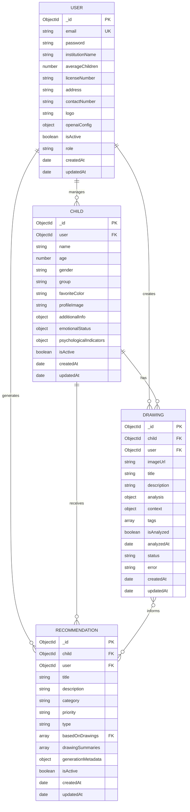
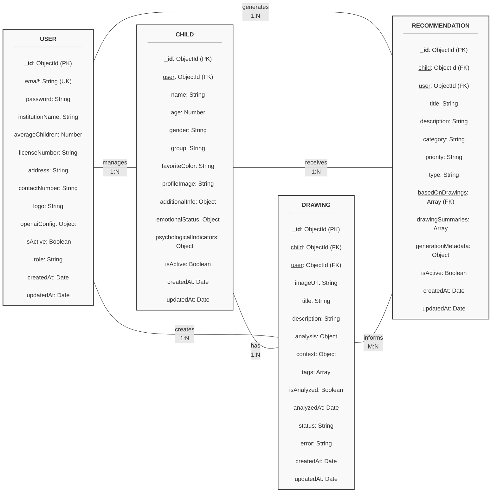

# Database Entity-Relationship Diagram

## Overview
This ERD represents the database schema for the Gaza Kid Mind Canvas application, which is designed to analyze children's drawings and provide psychological insights.

## ERD Diagram

## ERD Diagram (Horizontal Layout)

## Entity Descriptions

### USER Entity
Represents the system users (therapists/professionals) who manage children and analyze their drawings.
- **Primary Key**: _id (MongoDB ObjectId)
- **Unique Key**: email
- **Attributes**:
  - Authentication: email, password (hashed)
  - Institution details: institutionName, licenseNumber, address, contactNumber
  - Configuration: openaiConfig (for AI analysis)
  - Status: isActive, role (admin/user)
  - Timestamps: createdAt, updatedAt

### CHILD Entity
Represents the children whose drawings are being analyzed.
- **Primary Key**: _id (MongoDB ObjectId)
- **Foreign Key**: user (references USER)
- **Attributes**:
  - Basic info: name, age (1-18), gender (male/female)
  - Grouping: group (default: 'الافتراضي')
  - Personalization: favoriteColor, profileImage
  - Medical/Background info: additionalInfo object containing:
    - medicalHistory
    - familyBackground
    - previousAssessments
    - notes
  - Emotional indicators (0-100 scale):
    - happiness, sadness, anger, fear, anxiety
  - Psychological indicators (0-100 scale):
    - selfConfidence, socialInteraction, emotionalExpression
    - adaptability, cognitiveAbility
  - Status: isActive
  - Timestamps: createdAt, updatedAt

### DRAWING Entity
Represents individual drawings uploaded for analysis.
- **Primary Key**: _id (MongoDB ObjectId)
- **Foreign Keys**: 
  - child (references CHILD)
  - user (references USER)
- **Attributes**:
  - Core data: imageUrl, title, description
  - AI Analysis results stored in analysis object:
    - aiAnalysis: overallAssessment, emotionalIndicators, colorUsage, shapes, symbolism
    - psychologicalState: happiness, sadness, anger, fear, anxiety (0-100)
    - professionalNotes: manual notes by therapist
    - recommendations: array of recommendations
    - confidenceScore (0-100)
  - Context information:
    - environment: clinic/home/school/other
    - mood, activity, sessionNotes
  - Metadata: tags, isAnalyzed, analyzedAt, status, error
  - Timestamps: createdAt, updatedAt

### RECOMMENDATION Entity
Represents AI-generated or professional recommendations based on drawing analysis.
- **Primary Key**: _id (MongoDB ObjectId)
- **Foreign Keys**: 
  - child (references CHILD)
  - user (references USER)
  - basedOnDrawings (array referencing DRAWING)
- **Attributes**:
  - Content: title, description
  - Classification:
    - category: therapeutic/educational/behavioral/social/family
    - priority: high/medium/low
    - type: positive/warning/action
  - Source tracking:
    - basedOnDrawings: array of drawing references
    - drawingSummaries: detailed info about analyzed drawings
  - Generation metadata:
    - totalDrawingsAnalyzed, generatedAt, modelUsed
  - Status: isActive
  - Timestamps: createdAt, updatedAt

## Relationships

1. **USER to CHILD** (One-to-Many)
   - A user (therapist) can manage multiple children
   - Each child is managed by one user

2. **USER to DRAWING** (One-to-Many)
   - A user can create/upload multiple drawings
   - Each drawing is created by one user

3. **USER to RECOMMENDATION** (One-to-Many)
   - A user can generate multiple recommendations
   - Each recommendation is generated by one user

4. **CHILD to DRAWING** (One-to-Many)
   - A child can have multiple drawings
   - Each drawing belongs to one child

5. **CHILD to RECOMMENDATION** (One-to-Many)
   - A child can receive multiple recommendations
   - Each recommendation is for one child

6. **DRAWING to RECOMMENDATION** (Many-to-Many)
   - Multiple drawings can inform a recommendation
   - A recommendation can be based on multiple drawings
   - Implemented through the basedOnDrawings array in RECOMMENDATION

## Indexes

The database implements the following indexes for performance optimization:
- USER: email (unique index)
- CHILD: (user, isActive), (user, group)
- DRAWING: (child, createdAt), (user, status), (child, isAnalyzed)
- RECOMMENDATION: (child, createdAt), (child, priority, createdAt), (child, isActive, createdAt)

## Data Flow

1. A **USER** registers and sets up their institution profile
2. The **USER** adds **CHILD** records for the children they work with
3. The **USER** uploads **DRAWING**s for each **CHILD**
4. The system analyzes each **DRAWING** using AI
5. Based on the analysis, **RECOMMENDATION**s are generated
6. **RECOMMENDATION**s can be based on multiple **DRAWING**s to provide comprehensive insights